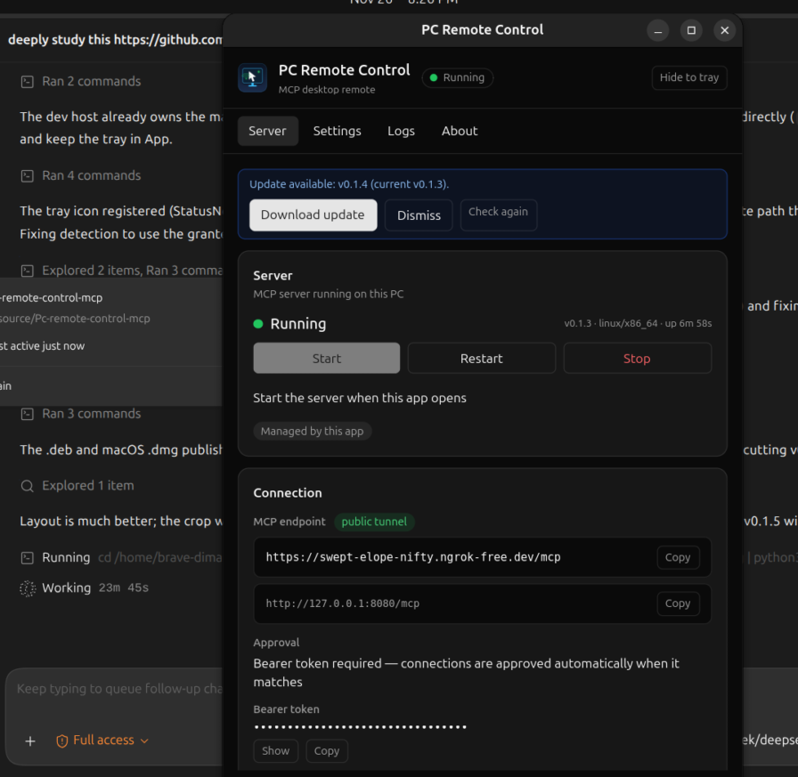

# PC Remote Control MCP

 

A **remote-control MCP server that runs on your own computer** — Linux, macOS or Windows — with a native
desktop app built with [nsh (Native Shell)](https://nsh.dev).

The concept follows [android-remote-control-mcp](https://github.com/danielealbano/android-remote-control-mcp):
the MCP server lives on the machine being controlled (there it was a phone, here it is a PC) and any MCP client
connects to it directly. The server exposes the desktop — screen, mouse, keyboard, clipboard, files, shell, windows,
processes, browser, documents, coding-agent CLIs, power and system administration — through **54 MCP tools**.

- **Stateless, JSON-only Streamable HTTP** at `POST /mcp` (same shape as the Android project), plus a `--stdio` transport.
- **Always-approve connections**: no OAuth dance, no approval dialog. An optional bearer token is verified
  automatically when enabled.
- **Remote access**: same-network LAN URL, or a public/tailnet URL through Cloudflare Quick Tunnels, Tailscale Serve
  or ngrok — with a hard requirement that the bearer token is enabled before a tunnel may start.
- **One Rust binary** (`pcrc-server`), no runtime dependencies; the UI is a TSX app that runs natively on GTK 4
  (Linux), AppKit (macOS) and Win32 (Windows).

## Architecture

```
┌─────────────────────────────── this PC ───────────────────────────────┐
│                                                                       │
│   MCP client (Claude, Cursor, any agent)                              │
│        │  POST /mcp  (JSON-RPC, stateless, optional bearer token)     │
│        ▼                                                              │
│   pcrc-server (Rust, tokio + axum)                                    │
│     • MCP tools ──► platform backends                                 │
│     │                Linux: X11/XTEST, uinput, xdg-desktop-portal,    │
│     │                       AT-SPI-free EWMH window list, CDP         │
│     │                macOS: screencapture, enigo, osascript           │
│     │                Windows: PowerShell/.NET, enigo, Win32           │
│     • Tunnel manager (cloudflared / tailscale / ngrok)                │
│     • Loopback admin API: /admin/status, /admin/logs, /admin/config,  │
│       /admin/token, /admin/tunnel, /admin/quit                        │
│        ▲                                                              │
│        │ HTTP on 127.0.0.1                                            │
│   nsh desktop app (TSX, GTK/AppKit/Win32)                              │
│     • starts/stops/monitors the server, edits its config               │
│     • live logs, connection info, capabilities, remote-access tunnel   │
└───────────────────────────────────────────────────────────────────────┘
```

## Quick start

Requirements: Rust 1.88+, and for the desktop app the `nsh` CLI. Linux GTK 4.14+ for the UI. Everything else
(browser, LibreOffice, tunnel clients, coding-agent CLIs) is optional — the server detects what is installed.

```sh
# Build the release server and install it on PATH (~/.local/bin)
./scripts/install.sh

# Headless server (config is created on first run)
pcrc-server

# Desktop app (spawns and manages the server)
nsh run ./ui --target linux     # or: --target macos / --target windows
```

The server listens on `127.0.0.1:8080` by default. Its config lives at
`~/.config/pc-remote-control-mcp/config.json` (`%APPDATA%` on Windows,
`~/Library/Application Support` on macOS).

The desktop app finds `pcrc-server` on `PATH` when it starts. To use a different binary, set its absolute path in the
app's Settings; an absolute path must also be listed in `ui/nsh.json`
(`capabilities.process.execute`), because nsh sandboxes child processes.

## Install from GitHub Releases

Prebuilt server binaries are published for each release
([Releases](https://github.com/ebiyepadedimaro-afk/Pc-remote-control-mcp/releases)):

| Platform | Asset |
|---|---|
| Linux x86_64 | `pcrc-server-linux-x86_64.tar.gz` |
| macOS Apple Silicon | `pcrc-server-macos-arm64.tar.gz` |
| macOS Intel | `pcrc-server-macos-x86_64.tar.gz` |
| Windows x86_64 | `pcrc-server-windows-x86_64.zip` |

Extract the archive, put `pcrc-server` (or `pcrc-server.exe`) on `PATH` (on Linux/macOS:
`install -m755 pcrc-server ~/.local/bin/`), then run `pcrc-server`. The desktop UI is the nsh app in `ui/`:
`nsh run ./ui --target linux|macos|windows` (or package it with `nsh package`).

### Bundled tunnel clients

`./scripts/fetch-tunnel-clients.sh` downloads the official tunnel clients for the current machine into `vendor/`
(cloudflared, ngrok, tailscale + tailscaled). `./scripts/install.sh` installs them next to `pcrc-server`; the server
prefers clients in its own directory, then `PATH`, so a distribution folder can ship server + clients together.
Tailscale can run from the bundled binaries in userspace mode without root and be driven through its socket
(`tunnel.tailscale_socket`).

## Updates

The server checks the latest GitHub release (`/admin/update`, cached for 10 minutes). The desktop app polls it every
30 minutes and shows an **Update available** banner with **Download update**, which opens the matching release asset
for this platform (or the release page). Update the binary by replacing it with the downloaded one and restarting the
app; your config is untouched.

## Connect an MCP client

**HTTP (recommended)**

```json
{
  "mcpServers": {
    "pc-remote-control": {
      "type": "http",
      "url": "http://127.0.0.1:8080/mcp"
    }
  }
}
```

Claude Code:

```sh
claude mcp add --transport http pc-remote-control http://127.0.0.1:8080/mcp
```

**stdio** (desktop clients without HTTP support)

```json
{
  "mcpServers": {
    "pc-remote-control": {
      "command": "pcrc-server",
      "args": ["--stdio"]
    }
  }
}
```

Try it with the inspector:

```sh
npx @modelcontextprotocol/inspector
# Transport: Streamable HTTP, URL: http://127.0.0.1:8080/mcp
```

When the bearer token is enabled, send `Authorization: Bearer <token>` (the token is shown in the app and via
`pcrc-server --print-token`). Connections are approved automatically once the token matches — there is never an
interactive approval step.

## Remote access (clients on another network)

A LAN URL such as `http://192.168.1.20:8080/mcp` only works when the client is on the same network. For a client
anywhere else, the **Remote access** card in the desktop app starts a tunnel and shows the public URL:

| Tunnel | URL shape | Account needed |
|---|---|---|
| **cloudflared** quick tunnel | `https://<random>.trycloudflare.com/mcp` | no |
| **Tailscale Serve** | `https://<machine>.<tailnet>.ts.net/mcp` (tailnet only) | Tailscale |
| **ngrok** | `https://<random>.ngrok-free.app/mcp` | ngrok authtoken |

The server **refuses to start a tunnel while the bearer token is disabled** (HTTP 409, `token_required`). The app
offers a one-click "Enable bearer token" step first. Point clients at the tunnel URL and add the token header:

```json
{
  "mcpServers": {
    "pc-remote-control": {
      "type": "http",
      "url": "https://example.trycloudflare.com/mcp",
      "headers": { "Authorization": "Bearer <token>" }
    }
  }
}
```

Install the tunnel client you prefer (`cloudflared` needs no account for quick tunnels; `tailscale up` gives a
private tailnet URL; ngrok needs an authtoken). For ngrok, either run
`ngrok config add-authtoken <token>` once, or paste the authtoken into the app's **Remote access** card — it is
stored in the server config (file mode `0600`) and passed to the ngrok agent at launch.

Set `tunnel.kind` (`ngrok`, `cloudflared`, `tailscale` or `auto`) and `tunnel.auto_start: true` to have the server
launch the tunnel automatically at startup. While a tunnel is running:

- `/admin/status.mcp_url` — and the app's **MCP endpoint**, the `About` snippets and `mcpUrl()` — switch to the
  public URL (`https://…/mcp`); `mcp_url_local` always keeps the loopback URL.
- The Remote access card shows the live URL with a copy button and a Stop control.
- The URL is per ngrok session (a new one after a server restart) unless you use a reserved/static domain. LAN URLs are also listed in the app, but are only
usable on the same network.

## Tools (54)

| Group | Tools |
|---|---|
| Screen | `screenshot`, `get_screen_state` |
| Mouse | `mouse_move`, `mouse_click`, `mouse_scroll`, `mouse_drag` |
| Keyboard | `key_press` (chords like `CTRL+SHIFT+T`), `type_text` |
| Clipboard | `get_clipboard`, `set_clipboard` |
| Files | `list_directory`, `read_file`, `write_file`, `delete_path`, `move_path`, `copy_path`, `make_directory`, `file_info`, `download_from_url` |
| Shell | `shell_exec` (timeout, output caps, blocklist) |
| Processes | `list_processes`, `kill_process` |
| Windows | `list_windows`, `focus_window` |
| System | `system_info` |
| Apps | `open_url`, `open_path`, `launch_app`, `notify`, `lock_screen` |
| Browser | `browser_open`, `browser_navigate`, `browser_get_content`, `browser_click`, `browser_type`, `browser_screenshot`, `browser_eval`, `browser_tabs`, `browser_close`, `fetch_page` |
| Documents | `doc_read`, `doc_info`, `doc_convert`, `doc_ocr` |
| Coding agents | `agent_list`, `agent_start`, `agent_status`, `agent_run`, `agent_stop`, `agent_jobs` |
| Power & admin | `power`, `admin_exec`, `service`, `terminal_run` |

Highlights:

- **Browser automation** runs a Chromium-based browser (Chrome/Chromium/Edge/Brave) with a dedicated profile and a
  loopback DevTools port, then drives it over CDP: navigate, read text/HTML/markdown, click by selector or coordinate,
  type, screenshot (viewport or full page), evaluate JavaScript, manage tabs. Headed or headless. `fetch_page` reads
  static pages without a browser.
- **Documents**: PDF text via `pdftotext` or the built-in Rust extractor; DOCX/PPTX via their XML; XLSX/XLS/ODS via
  `calamine`; HTML/CSV/markdown/JSON/XML/text directly. `doc_convert` uses LibreOffice headless for conversions such as
  docx→pdf, xlsx→csv, pptx→pdf. `doc_ocr` uses tesseract on images.
- **Coding agents**: detects Claude Code, Codex, Gemini CLI, Aider, opencode, Cursor CLI and GitHub Copilot, runs them
  non-interactively in a project directory as managed jobs (start/status/logs/stop/run), and can run any custom
  command with `{prompt}` substitution.
- **Power & administration**: shutdown/restart/hibernate/suspend/logout/lock with an optional delay; elevated command
  execution (`sudo -n`/root on Linux, macOS administrator prompt, UAC on Windows); service management (systemd,
  launchctl, Windows services); and `terminal_run` to open a visible terminal window running a command (handy for
  interactive `sudo`).

Coordinate behavior: screenshots are scaled to session coordinates by default (HiDPI-aware), so a pixel in the image
is a coordinate the input tools understand. Set `screenshot.match_input_coordinates` to `false` for native pixels.

## Security model

- **Always approve**: by default `token_enabled` is `false` and every MCP client that can reach the server is accepted.
  There is no OAuth flow and no approval dialog. This is the requested model; keep the bind address at `127.0.0.1`
  unless you have enabled the token.
- **Bearer token**: when enabled, requests without a matching `Authorization: Bearer …` (or `X-API-Key`) get 401.
  Tokens are compared in constant time and regenerated from the app or `POST /admin/token`.
- **Tunnel gate**: a remote tunnel cannot start unless the token is enabled.
- **Secrets on disk**: the config file (bearer token, ngrok authtoken) is written with mode `0600`.
- **Admin API is loopback-only**: `/admin/*` is refused for non-loopback clients; it is how the desktop app works.
- **Least privilege knobs**: file root and write/delete flags, shell on/off with blocklist, download limits and
  private-address blocking, per-tool-group disabling, and independent switches for power actions, elevated
  commands, terminal execution, coding agents and tunnels.
- **Reality check**: a connected client acts with **your** user rights. Disable tool groups you don't need, prefer a
  token even locally if other users share the machine, and expose the server publicly only through a tunnel with the
  token enabled (prefer Tailscale when possible).

## Platform notes

### Linux (tested here: Ubuntu 26.04, GNOME on Wayland)

- **Screenshots** use the xdg-desktop-portal on Wayland and X11 `GetImage` on X11.
- **Input** uses XTEST on X11 sessions. On Wayland, XTEST only reaches XWayland windows; full control needs write
  access to `/dev/uinput`. The app shows the exact rule and a copy button:

  ```sh
  sudo tee /etc/udev/rules.d/60-pcrc-uinput.rules >/dev/null <<'EOF'
  KERNEL=="uinput", GROUP="input", MODE="0660"
  EOF
  sudo modprobe uinput
  echo uinput | sudo tee /etc/modules-load.d/uinput.conf
  sudo usermod -aG input "$USER"
  # then log out and back in
  ```

  Absolute pointer positioning on Wayland uses a virtual absolute tablet device (experimental on some compositors);
  `input.backend` can force `x11` or `uinput`.
- **Window list** uses EWMH over X11/XWayland, so native Wayland windows are not listed.
- **Clipboard** uses arboard (X11/XWayland); the clipboard object is kept alive so copied text survives between calls.
- **Elevated commands** need root or a passwordless sudo rule (`sudo -n`). Otherwise use `terminal_run("sudo …")`.

### macOS

- Grant **Screen Recording** (screenshots) and **Accessibility** (input) in System Settings → Privacy & Security.
- `screencapture`, `enigo`, `osascript` (windows/notifications/admin prompt) and `pmset`/`CGSession` (power) are used.
- Some window automation asks for Automation permission once.

### Windows

- Normal screen/input/window/process tools need no special permissions.
- Elevation uses UAC (`Start-Process -Verb RunAs`); elevated output is not captured by design — use `terminal_run`
  when output matters.
- Screenshots use PowerShell + .NET; input uses enigo; services use PowerShell; notifications use a balloon tip.

### Optional dependencies

| Feature | Needs |
|---|---|
| Browser tools | Chrome, Chromium, Edge or Brave (auto-detected), or `browser.path` |
| PDF text | `pdftotext` (poppler) preferred; built-in extractor otherwise |
| Conversions | LibreOffice (`soffice`) |
| OCR | `tesseract` (+ language packs) |
| Coding agents | `claude`, `codex`, `gemini`, `aider`, `opencode`, `cursor-agent`, `copilot` |
| Remote tunnel | `cloudflared`, `tailscale` or `ngrok` |

## Configuration

`pcrc-server` owns one JSON file (`~/.config/pc-remote-control-mcp/config.json`). The desktop app edits it through the
admin API; the same fields can be edited by hand. Defaults shown:

```json
{
  "bind": "127.0.0.1",
  "port": 8080,
  "token_enabled": false,
  "token": "<auto-generated uuid>",
  "tool_prefix": "pc",
  "screenshot": {
    "format": "png", "jpeg_quality": 80,
    "max_width": 0, "max_height": 0,
    "match_input_coordinates": true
  },
  "shell": {
    "enabled": true, "default_timeout_ms": 30000, "max_timeout_ms": 300000,
    "max_output_bytes": 262144,
    "blocklist": [":(){:|:&};:", "rm -rf /", "mkfs.", "dd if=/dev/zero of=/dev/sd"]
  },
  "files": {
    "root": "", "allow_write": true, "allow_delete": true,
    "max_read_bytes": 10485760, "max_write_bytes": 10485760
  },
  "downloads": {
    "enabled": true, "max_bytes": 104857600, "timeout_ms": 120000,
    "allow_private_hosts": false
  },
  "input": { "backend": "auto" },
  "browser": {
    "path": "", "headless": false, "window_width": 1280, "window_height": 900,
    "profile_dir": ""
  },
  "docs": {
    "max_chars": 200000,
    "soffice_path": "", "pdftotext_path": "", "tesseract_path": ""
  },
  "agents": { "enabled": true, "max_jobs": 4, "max_runtime_ms": 1800000 },
  "system": {
    "power_enabled": true, "admin_enabled": true, "terminal_enabled": true,
    "tunnel_enabled": true, "max_delay_secs": 3600
  },
  "tunnel": { "kind": "auto", "auto_start": false, "ngrok_authtoken": "" },
  "tools": { "disabled": [] },
  "log_lines": 500
}
```

CLI flags: `--config <path>`, `--bind <addr>`, `--port <n>`, `--stdio`, `--print-token`, `--setup-uinput`.

## Desktop app

Four pages:

- **Server** — status, start/restart/stop, autostart, MCP endpoint and token with copy buttons, same-network URLs,
  remote-access tunnel, live activity counters, and a capability report (screenshot/input backends, browser,
  converters, coding agents) including the uinput setup when needed.
- **Settings** — network/bind/port/tool prefix, token toggle and regeneration, tool-group switches, screenshot and
  input backend, shell/files/downloads limits, browser, document tools, coding agents, power/admin/tunnel switches.
  Bind/port changes require a restart; everything else applies immediately.
- **Logs** — live log stream (server ring buffer plus process output), level filter, clear.
- **About** — client configuration snippets (HTTP and stdio), the live tool list with descriptions, and permissions
  notes.

`cd ui && nsh check && nsh test && nsh build` validates the app. `nsh package` produces installable packages per nsh's
signing/packaging flow.

**App icon:** `ui/assets/icon.png` (1024×1024, with 512/256 and `.ico` exports in the same folder). `ui/nsh.json`
declares `"icon": "assets/icon.png"`, so `nsh package --target linux|macos|windows` embeds it: the Linux package
contains `com.pcrc.control.png` and a `.desktop` file with `Icon=com.pcrc.control`; Windows embeds it in the `.exe`.
The dev host (`nsh run`) shows the nsh runtime icon; the app icon appears in the packaged app.

## Repository layout

```
server/           Rust MCP server (pcrc-server)
  src/main.rs       CLI, transports
  src/mcp.rs        stateless JSON-RPC dispatch
  src/http.rs       /mcp + loopback admin API
  src/tools/        tool registry and groups (screen, mouse, …)
  src/platform/     Linux / macOS / Windows backends
  src/tunnel.rs     remote-access tunnel manager
ui/               nsh desktop app (TSX) with capabilities manifest
scripts/install.sh
tests/e2e.py      end-to-end MCP/admin test suite
docs/ui.png
```

## Testing

```sh
# server end-to-end (uses a running server; non-destructive)
pcrc-server --port 8091 &
PCRC_BASE=http://127.0.0.1:8091 python3 tests/e2e.py

# UI
cd ui && nsh check && nsh test && nsh build
```

The suite covers initialize/tools list, screenshot via the Wayland portal, screen state, clipboard round-trip,
file operations, shell + timeout, processes, `fetch_page`, a full headless-Chrome session (navigate/content/eval/
click/type/screenshot/tabs/close), DOCX/XLSX generation and reading, DOCX→PDF conversion via LibreOffice and PDF
reading, agent detection plus custom agent jobs, service status, the admin API, token gating (401/200) and the stdio
transport. It never shuts down, suspends or reboots the machine; it restores the clipboard and the token setting it
toggles.

## Status and limitations

- **Linux is verified end-to-end** (55/55 checks on Ubuntu 26.04 / GNOME Wayland). macOS and Windows backends are
  implemented behind `cfg` but were not executable on this Linux machine; treat them as needing a first-run shakeout.
- Wayland absolute pointer input through uinput is experimental (virtual tablet); X11 sessions are precise. Native
  Wayland windows are not in the window list.
- Browser tools need a Chromium-based browser; Firefox is not CDP-compatible.
- Coding-agent non-interactive flags differ between CLI versions; `args`/`command` overrides are provided, and
  `agent_list` shows what was detected.
- Tunnel start requires the bearer token; live tunnel URLs depend on the external client being installed and
  configured (`cloudflared`, `tailscale up`, `ngrok config add-authtoken`).
- Elevated commands on Linux require root or passwordless sudo; macOS shows a system administrator prompt; Windows
  shows UAC and does not capture elevated output.

## License

MIT. The concept is inspired by
[danielealbano/android-remote-control-mcp](https://github.com/danielealbano/android-remote-control-mcp) (GPL-3.0);
this repository is an independent implementation for desktop operating systems.
